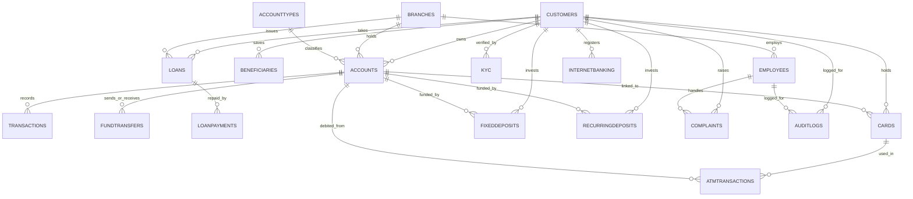

#  Banking System Database (MySQL)
 
A complete relational banking database built in MySQL. It covers schema design for 18 tables, sample data, and a full SQL learning path: filtering, joins, subqueries, CTEs, window functions, views, indexes, stored procedures, functions, triggers and recursive CTEs.

 


 
---
 

##  Project Overview
 
| Item | Details |
|---|---|
| **Database** | MySQL 8.0+ |
| **Database name** | `BankingSystem` |
| **Script** | `Banking_System_Project.sql` |
| **Domain** | Banking / Financial Services |
| **Tables** | 18 |
| **Views** | 8 |
| **Indexes** | 8 |
| **Stored procedures** | 8 |
| **Stored functions** | 8 |
| **Triggers** | 8 |
 
The project models how a retail bank works: customers open accounts at branches, make transactions and fund transfers, take loans, hold cards, FDs and RDs, complete KYC, raise complaints, and use internet banking. All important actions are tracked in an audit log.
 
---
 
##  Database Schema
 
### Tables
 
| # | Table | Description |
|---|---|---|
| 1 | `Branches` | Branch name, code, address, manager, status |
| 2 | `Customers` | Customer personal details, contact info, status |
| 3 | `AccountTypes` | Savings, Current, Salary, Senior Citizen, NRI with minimum balance & interest rate |
| 4 | `Accounts` | Customer accounts linked to a branch and account type, with balance |
| 5 | `Transactions` | Deposits, withdrawals and transfers per account |
| 6 | `Beneficiaries` | Saved payees of a customer (bank, IFSC, nickname) |
| 7 | `FundTransfers` | NEFT / RTGS / IMPS / UPI transfers between accounts |
| 8 | `Loans` | Loan type, amount, interest rate, tenure, status |
| 9 | `LoanPayments` | Loan repayments |
| 10 | `Cards` | Debit / Credit cards with expiry and daily limit |
| 11 | `FixedDeposits` | FD principal, rate, tenure, maturity amount |
| 12 | `RecurringDeposits` | RD monthly amount, rate, tenure, maturity amount |
| 13 | `ATMTransactions` | ATM withdrawals, deposits and balance inquiries |
| 14 | `KYC` | Document type, number, verification status |
| 15 | `Employees` | Branch staff with job title, salary, status |
| 16 | `Complaints` | Customer complaints with priority, status and assigned employee |
| 17 | `InternetBanking` | Online banking users (hashed passwords, last login) |
| 18 | `AuditLogs` | Automatic log of important actions (filled by triggers) |
 
### Entity Relationship Diagram
 

 
> `FundTransfers` links to `Accounts` twice: once as sender and once as receiver.
 
---
 
##  Sample Dataset
 
| Table | Rows |
|---|---|
| AccountTypes | 5 |
| Branches | 6 |
| Employees | 9 |
| Customers | 10 |
| Accounts | 10 |
| Transactions | 13 |
| Beneficiaries | 10 |
| FundTransfers | 10 |
| Loans | 10 |
| LoanPayments | 11 |
| Cards | 10 |
| FixedDeposits | 10 |
| RecurringDeposits | 10 |
| ATMTransactions | 10 |
| KYC | 10 |
| Complaints | 10 |
| InternetBanking | 10 |
| AuditLogs | 10 |
 
---
 
## 🧠 SQL Topics Covered
 
| Step | Topic | What it demonstrates |
|---|---|---|
| 1–19 | Schema design | `PRIMARY KEY`, `FOREIGN KEY`, `UNIQUE`, `DEFAULT`, `CHECK` constraints |
| 20–37 | Data loading | `INSERT` for all tables |
| 38–39 | Basic queries | `SELECT`, `ORDER BY`, `LIMIT` |
| 40 | Filtering | `WHERE`, `AND/OR`, `IN`, `BETWEEN`, `LIKE` |
| 41 | SQL functions | String, numeric and date functions |
| 42 | Aggregation | `GROUP BY`, `HAVING` |
| 43 | DISTINCT & NULL handling | `DISTINCT`, `IS NULL`, `COALESCE` |
| 44–48 | Joins | `INNER`, `LEFT`, `RIGHT`, `SELF` and multi-table joins |
| 49 | Subqueries | Scalar, `IN`, `EXISTS` and correlated subqueries |
| 50 | CTEs | `WITH` clause for readable multi-step queries |
| 51 | Set operations | `UNION`, `UNION ALL` and related patterns |
| 52 | Window functions | `RANK`, `DENSE_RANK`, `ROW_NUMBER`, `LAG`, running totals |
| 53 | Views | 8 reusable views |
| 54 | Indexes | 8 indexes for faster lookups |
| 55–56 | Stored procedures | 8 procedures with `IN` parameters, plus execution examples |
| 57 | Stored functions | 8 functions returning single values |
| 58 | Triggers | 8 triggers writing to `AuditLogs` |
| 59 | Recursive CTEs | Number series, monthly periods, weekly dates |
 
### Views
 
`CustomerAccountDetails` · `CustomerLoanDetails` · `BranchEmployeeDetails` · `CustomerTransactionDetails` · `HighBalanceAccounts` · `PendingKYC` · `HighValueLoans` · `AccountSummary`
 
### Stored Procedures
 
`GetAllCustomers` · `GetCustomersByCity` · `GetAccountsAboveBalance` · `GetLoansByType` · `GetTransactionsByAccount` · `GetEmployeesByBranch` · `GetPendingKYCCustomers` · `GetHighValueLoans`
 
### Stored Functions
 
`GetCustomerName` · `GetAccountBalance` · `GetCustomerLoanAmount` · `GetCustomerAccountCount` · `GetTotalTransactionAmount` · `GetAverageLoanInterestRate` · `GetPendingKYCCount` · `GetTotalLoanPayments`
 
### Triggers (Audit Logging)
 
| Trigger | Fires on |
|---|---|
| `AfterTransactionInsert` | New transaction |
| `AfterAccountBalanceUpdate` | Account balance change |
| `AfterCustomerInsert` | New customer |
| `AfterLoanPaymentInsert` | New loan payment |
| `AfterComplaintStatusUpdate` | Complaint status change |
| `AfterFundTransferInsert` | New fund transfer |
| `AfterKYCStatusUpdate` | KYC status change |
| `AfterLoanDelete` | Loan deleted |
 
---
 
##  How to Run
 
1. Install **MySQL 8.0 or later** (CTEs, window functions and `CHECK` constraints are required).
2. Clone this repository:
 
   ```bash
   git clone https://github.com/<your-username>/<your-repo-name>.git
   cd <your-repo-name>
   ```
 
3. Run the script:
 
   ```bash
   mysql -u <username> -p < Banking_System_Project.sql
   ```
 
   or open `Banking_System_Project.sql` in MySQL Workbench and execute it step by step.
 
>  Procedures, functions and triggers use `DELIMITER //`. In the MySQL CLI or Workbench this works as is; some GUI tools need the delimiter set manually.
 
---
 
##  Design Highlights
 
- **Data integrity:** foreign keys on every relationship, `CHECK` constraints (balance ≥ 0, amount > 0, valid transaction / transfer / card types, valid KYC and complaint statuses).
- **Security:** internet banking stores `password_hash`, never plain-text passwords.
- **Auditability:** triggers automatically record inserts, updates and deletes in `AuditLogs`.
- **Performance:** indexes on email, phone, balance, transaction account, transfer date and loan fields.
- **Reusability:** views, procedures and functions wrap the most common reports.
 
---
 
##  Tech Stack
 
- **MySQL 8.x**
- SQL: DDL, DML, joins, subqueries, CTEs, recursive CTEs, window functions, views, indexes, stored routines, triggers
 
---
 
##  Notes
 
- All data is **synthetic** and meant for learning and portfolio use.
- Passwords, card numbers and account numbers in the sample data are dummy values.
 
##  Possible Improvements
 
- Add a `Branch → Region` hierarchy so the recursive CTE shows a real parent-child tree.
- Add stored procedures for fund transfer and loan EMI calculation with transaction control (`START TRANSACTION`, `COMMIT`, `ROLLBACK`).
- Add role-based access (`GRANT` / `REVOKE`) examples.
- Connect the database to Power BI / Tableau for dashboards.
 
---
 
##  Author
 
**Ariba**
SQL | Data Analytics | Portfolio Project
 
